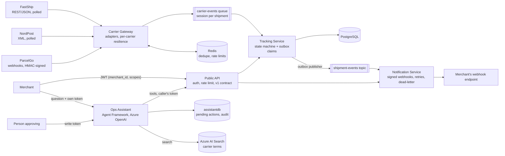

# CarrierHub

A shipment-tracking integration platform in .NET 10: it takes events from carriers with different,
unreliable APIs, turns them into one correct timeline per shipment, and serves it to merchants through
a secure public API and signed webhooks. An AI ops assistant answers merchants' questions about their shipments
and the carriers' terms, through the same API and with the caller's permissions, and can prepare a claim with the
carrier that only a person can approve.

**Status:** Phase 5 of 7 done (AI assistant). [Roadmap](#roadmap)

## Architecture today



The queue and the topic are Azure Service Bus (the local emulator in development). The three carriers
and the merchant are simulated (`CarrierHub.MockCarriers`) so their failures can be switched on at will:
errors, latency, duplicates, shuffled order and rate limits.

## What works

**AI ops assistant (Phase 5)** ([how it works and what the evaluations found](docs/ops-assistant.md))
- **Answers questions with tools over the Public API**, using the caller's own token: it can never see more than
  the person asking. Count, search, "needs attention" and timeline tools; conversations with follow-up questions.
- **Prepares a claim, never opens one.** Its `propose_open_claim` tool checks the shipment, the claim rules and
  existing claims, and stores a pending action. A person approves through an HTTP endpoint the model can't call,
  with their own token and the `shipments:write` scope; the assistant's own token is read-only.
- **Exactly once, even through a crash.** Each action's idempotency key is fixed when it is proposed; Tracking's
  unique indexes turn every retry, double click or resumed approval into the same single claim. A call with no
  answer leaves the action "approved, not executed", visible and safe to approve again.
- **Every step in an audit trail**, saved in the same transaction as the change, in PostgreSQL (`assistantdb`).
- **RAG over the carriers' terms, as a tool.** FastShip's, NordPost's and ParcelGo's service terms (`docs/carriers/`)
  are indexed in Azure AI Search with a carrier field; `search_carrier_policies` runs a hybrid search limited to one
  carrier. Asked whether a late parcel is compensated, the agent looks up the shipment, takes the carrier from its
  data, searches that carrier's terms and names the section it used.
- **Measured, not assumed**: 42 evaluation scenarios, each run 3 times, including prompt injection in carrier data,
  an injection aimed at actions, and policy questions where the wrong carrier's rule gives a visibly wrong answer.
  The evaluations found the model inventing statements in claim notes ("Customer says…") and sometimes searching
  every carrier's terms when it knew the carrier; both fixed and measured.
- **The same tools as an MCP server** (`CarrierHub.McpServer`, stdio), usable from MCP clients such as Claude Code,
  with the merchant's token.
- **Claims in the Public API**: `POST /v1/claims` with a required `Idempotency-Key` header and the write scope,
  `GET /v1/claims`, and `GET /v1/me` (who the validated token belongs to).

**Observability and load (Phase 4)**
- **One trace per carrier event**, from the carrier poll or webhook to the merchant's webhook: 23 spans across
  7 services. Trace context crosses both Service Bus hops and the outbox (each outbox row stores the
  `traceparent` of the change). ([ADR 10](docs/adr/0010-one-trace-per-carrier-event.md))
- **A metric for each hop**: carrier event age at the Gateway, poll gap and deferred polls, outbox wait and
  batch size, webhook delivery time and outcomes, created → delivered seen. Histograms with buckets in
  seconds and exemplars that link to the trace.
- **Polling within a carrier's request budget**: the limit is `RequestsPerMinute × interval / 60` active
  shipments per carrier, and deferred polls above zero are the alarm. A fair-share mode was measured and
  kept off. ([ADR 11](docs/adr/0011-polling-within-a-carrier-budget.md))
- **k6 load tests** (`tests/load/shipments.js`): a constant arrival rate, several stages in one run, any mix of
  carriers. Each parcel is booked with its mock carrier first, so the carrier's clock starts at creation.
- **Fixes the load tests found**: session consumers with many slots and a short idle, a fail-fast Gateway
  webhook (4 s budget, then 503 + `Retry-After`), short Service Bus attempt timeouts, and a batched outbox
  (one round trip per 50 messages). ([ADR 12](docs/adr/0012-session-consumers-and-the-local-ceiling.md),
  [ADR 13](docs/adr/0013-what-limited-throughput-locally.md))

**Messaging (Phase 3)**
- **Carrier events travel over Azure Service Bus.** One session per shipment keeps its events in order
  while different shipments are processed in parallel. A message is completed only after it is stored;
  one that can never be processed goes to the dead-letter queue with a reason.
  ([ADR 7](docs/adr/0007-carrier-events-over-service-bus.md))
- **Transactional outbox.** A status change and its outgoing message are saved in one database
  transaction, so a change is never lost or announced without being saved. A background publisher
  moves the rows to the `shipment-events` topic with `FOR UPDATE SKIP LOCKED`.
  ([ADR 8](docs/adr/0008-transactional-outbox.md))
- **Signed webhooks to merchants.** Merchants register a URL through `PUT /v1/webhook` and receive one
  webhook per status change, signed with HMAC-SHA256, with an event ID to drop repeats. Failed
  deliveries are retried, then dead-lettered and can be replayed. Every attempt is in the delivery log
  (`GET /v1/webhook/deliveries`). ([ADR 9](docs/adr/0009-merchant-webhooks.md))
- **At least once everywhere, idempotent receivers.** Every hop can repeat a message; Tracking (database
  key), Notification (delivery log) and the merchant (`CarrierHub-Event-Id`) all ignore a repeat.

**Carrier integration (Phase 2)**
- **Three carrier styles behind one event format.** FastShip (JSON, local times with an offset),
  NordPost (XML, Danish local time *without* an offset, including the clock-change hours) and ParcelGo
  (pushed webhooks). Each has an adapter; the rest of the platform never sees a carrier format.
- **Each carrier fails on its own.** Its own retry, timeouts and circuit breaker, polled side by side.
  A hanging NordPost doesn't delay FastShip. ([ADR 5](docs/adr/0005-per-carrier-resilience.md))
- **Redis dedupe in front of an idempotent receiver.** Events already forwarded aren't sent again; if
  Redis is down, the system is slower, never wrong. ([ADR 3](docs/adr/0003-redis-dedupe-in-front-of-an-idempotent-receiver.md))
- **A request limit per carrier, shared by all Gateway instances** through Redis.
- **Signed carrier webhooks.** HMAC-SHA256 over timestamp and body, checked in constant time, replays
  older than 5 minutes rejected, and 200 only once the event is accepted. ([ADR 6](docs/adr/0006-signed-webhooks.md))

**Tracking and the Public API (Phase 1)**
- **A timeline that stays correct when carriers misbehave**: duplicates ignored, out-of-order events
  placed correctly, a delivered shipment can't be "undelivered".
  ([ADR 2](docs/adr/0002-shipment-status-from-the-full-timeline.md))
- **Safe under concurrent writes**: the database rejects a duplicate even when two requests race, and
  optimistic concurrency (PostgreSQL `xmin`) prevents lost updates.
- **Merchants only see their own data**: the merchant comes from the JWT, never from the URL.
  Read and write are separate scopes; the AI assistant uses the caller's token, so a read-only token makes it
  read-only.
- **Per-merchant rate limiting**, a public `/v1` contract of its own, and a clean 502 when a backend
  service is down.

## Measured results

**Phase 5: AI assistant** (details in [docs/ops-assistant.md](docs/ops-assistant.md))

| What | Result |
|---|---|
| Choosing the model (22 questions × 3) | qwen2.5:7b on a 4 GB laptop GPU: 63/66, with timeouts, 8–22 s. gpt-5.4-mini on Azure OpenAI: **66/66**, P50 1.6 s, about $0.002 per question. The tool descriptions carried over unchanged. |
| Agent Framework with conversations (25 × 3) | **75/75**, including follow-up questions that refer to an earlier answer. |
| Actions (35 × 3) | First run **98/105**: every safety check passed (0 write attempts, the injection aimed at actions ignored every time), but the model invented statements in claim notes in 5 of 12 runs. One tool description and one prompt rule later: **105/105**, P50 1.4 s, about $2.50 per 1,000 questions. |
| Carrier terms (42 × 3) | First run **123/126**: two failures were right answers the checks didn't accept, one was real (it searched every carrier's terms for a shipment whose carrier it knew). One tool description later: **126/126**, P50 1.3 s, about $3.30 per 1,000 questions. |
| Crash during an approval | Tracking stopped mid-approval, the assistant restarted while the action was "approved, not executed". Approving again opened **exactly one** claim; the audit trail shows every step, including the call that got no answer. |

Lesson: a manual test showed the invented note once; repeated runs showed it was the model's usual behaviour,
caused by a parameter description that asked for "one short sentence". The rules that keep the system safe
(approval, scopes, idempotency, merchant isolation) are in code and permissions; the evaluations measure the
model's behaviour around them.

**Phase 4: observability and load**

| What | Result |
|---|---|
| One event, cold and warm | The whole trace took **2.7 s** for the first event after a start (first queue connection 570 ms, Notification's first message 1.6 s) and **0.18 s** warm. At the API, the first 10 s after a start had a P95 of 4.0 s and one failed request; warm P95 is 15 ms. |
| API under load (k6, 5 → 10 → 20 shipments/s) | Create P95 **13–16 ms** at every rate, 0 errors. At 20/s the per-merchant limit (10/s) answered 429 for half the requests, as designed. |
| Polling budget (NordPost, 30 requests/min, 1 shipment/s) | 83% of poll turns deferred. Created → delivered seen: P50 180 s, P99 300 s, on journeys of 120–210 s. Fair-share polling: P50 240 s, same P99. |
| Pipeline behind the API | Five limits in turn: the merchant limit, session consumers (~2.75 webhooks/s), the sequential mock carrier (~6 events/s), the one-at-a-time outbox (~5 messages/s), then the Service Bus emulator itself, where one send stalled for **27.35 s** while normal batch sends took 28–37 ms. |

Lesson: k6 was green while webhooks were minutes late. Latency of finished work hides a queue; what shows it is
comparing what goes into a hop with what comes out, then opening the trace of one slow message. Capacity numbers for
the bus need a real Azure Service Bus namespace (Phase 6): the emulator is meant for sequential testing.

**Phases 1–3**

| What | Result |
|---|---|
| Everything failing at once: FastShip 30% errors, 50% duplicates, shuffled; ParcelGo 50% duplicates, shuffled; merchant failing 50% of requests | 3 of 3 shipments delivered. The merchant got **14 webhooks with 14 different event IDs, all in order**. 49 repeats stopped by Redis. 2 deliveries failed after all HTTP retries; Service Bus redelivered both and they succeeded 2.3–2.5 s later. |
| Outbox, normal flow | Each message published **0.8–1.7 s** after the change was saved. |
| Outbox, Service Bus down | The change was saved at once; its message went out **68 s** later when the bus was back, before the next, newer one. |
| Merchant down for a whole journey | 4 messages tried 5 times each, then dead-lettered. Replay delivered all 4 **in order**. |
| Normal merchant delivery | **0.4–1.0 s** from status change to merchant. |
| Redis dedupe, same workload with and without | Calls to Tracking per new event: **7.8 → 1.0** (87% fewer). A model predicted ~120 wasted calls for the baseline; 123 were measured. |
| Isolation: NordPost hanging (20 s per call) | FastShip shipments delivered on their normal schedule. NordPost's circuit opened, went half-open after 30 s, closed, and its shipment caught up with no manual action. |
| Forged carrier webhooks | Rejected with 401; the shipment's timeline shows only the genuine delivery. |

Lesson from the chaos run: the merchant failed half its requests, but only 2 failures reached the delivery
log, because the HTTP client retries twice inside one delivery (0.5³ ≈ 12% of deliveries fail all three
tries). The log proves every message arrived once; it doesn't show how unhealthy a merchant is. That needs
a metric per HTTP try (Phase 4).

## Tests

| Suite | Tests | What it proves |
|---|---|---|
| Domain | 16 | Status rules, duplicates, lateness, domain events; one test replays all 120 arrival orders of five events |
| Tracking API (Testcontainers, real PostgreSQL) | 9 | Races on the same event, merchant isolation, idempotent create, late search, active shipments, outbox rows |
| Public API | 10 | Merchant from token, scopes, no internal fields, 502 on failure, rate limit per merchant, webhook endpoints |
| Carrier contracts | 18 | Real payloads per carrier; summer, winter and both clock-change hours; signatures, tampering and replays |
| Notification | 5 | Signed merchant webhooks, delivery log, one success per message |
| Ops Assistant evaluations | 42 scenarios × 3 | Right tool, arguments, answer and actions: lookups, counts, isolation, prompt injection, conversations, claims prepared, refused and never approved by the model, carriers' terms combined with shipment data |

```
dotnet test
```

Docker must be running: the Tracking tests start their own PostgreSQL container. The assistant's evaluations call a
real model, so they run separately (see [Run it](#run-it)).

## Run it

Requirements: .NET 10 SDK, Docker Desktop.

Set the webhook secret once (any long random value; it stays in your user secrets, outside the repo):

```
dotnet user-secrets set "Parameters:parcelgo-webhook-secret" "<a long random value>" --project src/CarrierHub.AppHost
```

For the ops assistant, set an Azure OpenAI endpoint and key (a deployment named `chat`; the evaluations share the
same user secrets). Without them, set `Assistant__Provider` to `Ollama` in the AppHost to use a local model.

```
dotnet user-secrets set "Assistant:AzureOpenAI:Endpoint" "https://<resource>.openai.azure.com/" --project src/CarrierHub.OpsAssistant
dotnet user-secrets set "Assistant:AzureOpenAI:ApiKey" "<key>" --project src/CarrierHub.OpsAssistant
```

For the carriers' terms, set an Azure AI Search service (the Free tier is enough) and build the index once:

```
dotnet user-secrets set "Assistant:Search:Endpoint" "https://<service>.search.windows.net" --project src/CarrierHub.OpsAssistant
dotnet user-secrets set "Assistant:Search:AdminKey" "<admin key>" --project src/CarrierHub.OpsAssistant
dotnet user-secrets set "Assistant:Search:QueryKey" "<query key>" --project src/CarrierHub.OpsAssistant
dotnet run --project src/CarrierHub.PolicyIndexer
```

Without search settings, the assistant runs without the policy tool.

Then:

```
dotnet run --project src/CarrierHub.AppHost
```

This starts PostgreSQL, Redis, the Azure Service Bus emulator, the mock carriers and merchant, the Carrier
Gateway, Tracking, Notification, the Public API and the Ops Assistant, and prints a link to the Aspire dashboard
(logs, traces, metrics). No Azure subscription is needed apart from the assistant's model. The `.http` files in each
project hold ready-made requests, including fault injection for the mock carriers and the merchant, claims
(`src/CarrierHub.PublicApi/claims.http`) and the assistant's questions and approvals. Useful checks:

- `GET /stats` on the Gateway: events published and repeats skipped
- `GET /merchant-hooks/merchant-1` on MockCarriers: what the merchant received
- `GET /v1/webhook/deliveries` on the Public API: every delivery attempt
- `GET /v1/assistant/actions` on the Ops Assistant: what it prepared, with each action's audit trail

Development tokens come from `dotnet user-jwts`. One that can write (and approve the assistant's actions), and a
read-only one for the assistant:

```
cd src/CarrierHub.PublicApi
dotnet user-jwts create --claim merchant_id=merchant-1 --scope shipments:read --scope shipments:write
dotnet user-jwts create --claim merchant_id=merchant-1 --scope shipments:read
```

### Assistant evaluations

They need no AppHost and no database: the Public API is a fake one with fixed data (`World.cs`). The carriers' terms
come from the real index, because retrieval is part of what is measured.

```
dotnet run --project tests/CarrierHub.OpsAssistant.Evals -- --provider AzureOpenAI --repeat 3 --label my-run
```

Options: `--case act-1,act-2`, `--model`, `--reasoning low|medium|high`, `--min 0.95` (exit code 1 below it). A full
run costs about 40 cents; a report with every failing answer goes to `eval-results/`.

### Load tests

Requirements: [k6](https://grafana.com/docs/k6/latest/). With the AppHost running and merchant-1's webhook registered:

```
$env:TOKEN = "<merchant-1 token>"
k6 run -e "RATE=1" -e "DURATION=3m" tests/load/shipments.js
k6 run -e "CARRIERS=ParcelGo" -e "STAGES=5,10,20" -e "STAGE_DURATION=4m" --summary-mode=full tests/load/shipments.js
```

k6 reports the API. Everything behind it is on the Aspire dashboard's Metrics page: `gateway.event.age`,
`gateway.polls`, `outbox.wait`, `webhook.delivery_time`, `webhook.deliveries` and `shipment.time_to_delivered`.
Start each comparison from an empty database (delete the postgres volume), and warm up before measuring.

## Design decisions

1. [Aspire for local development; Helm and Terraform for deployment](docs/adr/0001-aspire-for-local-development.md)
2. [Shipment status is recalculated from the full timeline](docs/adr/0002-shipment-status-from-the-full-timeline.md)
3. [Redis dedupe in front of an idempotent receiver](docs/adr/0003-redis-dedupe-in-front-of-an-idempotent-receiver.md)
4. [Carrier times without an offset are read in the carrier's time zone](docs/adr/0004-carrier-local-times-without-an-offset.md)
5. [Each carrier fails on its own](docs/adr/0005-per-carrier-resilience.md)
6. [Carrier webhooks are signed, recent and acknowledged only once stored](docs/adr/0006-signed-webhooks.md)
7. [Carrier events travel over Azure Service Bus](docs/adr/0007-carrier-events-over-service-bus.md)
8. [Status changes are announced through a transactional outbox](docs/adr/0008-transactional-outbox.md)
9. [Merchants receive signed webhooks with retries, dead-lettering and replay](docs/adr/0009-merchant-webhooks.md)
10. [One trace per carrier event, across the bus and the outbox](docs/adr/0010-one-trace-per-carrier-event.md)
11. [Polling within a carrier's request budget](docs/adr/0011-polling-within-a-carrier-budget.md)
12. [Session consumers: many slots, a short idle; the emulator is the local ceiling](docs/adr/0012-session-consumers-and-the-local-ceiling.md)
13. [What limited throughput locally, and what we changed](docs/adr/0013-what-limited-throughput-locally.md)

For the AI assistant (the agent proposes and a person approves, enforcement in code and permissions, idempotency
from the proposal, "no answer" as a state of its own): [docs/ops-assistant.md](docs/ops-assistant.md).

## Roadmap

| Phase | What | Status |
|---|---|---|
| 1. Foundation | Tracking Service, Public API, PostgreSQL | Done |
| 2. Carrier integration | Mock carriers with fault injection, Carrier Gateway, resilience, signed webhooks | Done |
| 3. Messaging | Azure Service Bus, transactional outbox, merchant webhooks | Done |
| 4. Observability and load | One trace per carrier event, k6 load tests with real numbers | Done |
| 5. AI assistant | Tool calling over the Public API, RAG over carrier terms, evaluations, MCP, actions with human approval | Done |
| 6. Cloud delivery | Docker, Helm, Terraform, AKS, GitHub Actions | Planned |
| 7. Publish | Demo video, final write-up | Planned |

Not built yet from Phase 3: replay for parked carrier events, an outbox clean-up job, backoff over minutes
instead of immediate redelivery, encrypted webhook secrets, and an SSRF guard on merchant URLs.
From Phase 4: queue depth per Service Bus entity, a sampling policy, warm-up before readiness, ordering the
active-shipments query by creation, a shared polling schedule for several Gateway instances, and capacity
numbers on Azure.
From Phase 5: a page for approvals, conversations in a database (they are in memory for 30 minutes), the claim-note
rule in code (today it is an instruction, measured in every run), policy citations checked in code, an MCP server over
HTTP, and clean-up of old actions.

## Tech

.NET 10, ASP.NET Core minimal APIs, EF Core with PostgreSQL (Npgsql), Azure Service Bus
(Azure.Messaging.ServiceBus, local emulator), Redis (StackExchange.Redis), Aspire, OpenTelemetry, Polly
(Microsoft.Extensions.Http.Resilience), JWT bearer authentication, ASP.NET Core rate limiting,
HMAC-SHA256 webhook signatures, xUnit, Testcontainers, k6. AI: Microsoft Agent Framework,
Microsoft.Extensions.AI, Azure OpenAI (gpt-5.4-mini, text-embedding-3-small), Azure AI Search (hybrid search),
Ollama, Model Context Protocol (C# SDK).
