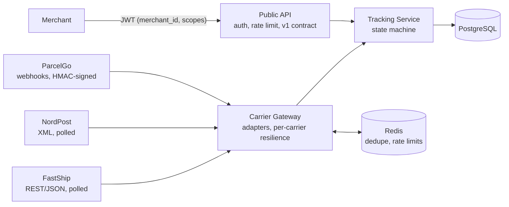

# CarrierHub

A shipment-tracking integration platform in .NET 10: it takes events from carriers with different,
unreliable APIs, turns them into one correct timeline per shipment, and serves it to merchants through
a secure public API. An AI ops assistant will answer questions about shipments through the same API,
with the caller's permissions.

**Status:** Phase 2 of 7 done (carrier integration). [Roadmap](#roadmap)

## Architecture today



The three carriers are simulated (`CarrierHub.MockCarriers`) so their failures can be switched on at will:
errors, latency, duplicates, shuffled order and rate limits.

## What works

**Carrier integration (Phase 2)**
- **Three carrier styles behind one event format.** FastShip (JSON, local times with an offset),
  NordPost (XML, Danish local time *without* an offset, including the clock-change hours) and ParcelGo
  (pushed webhooks). Each has an adapter; the rest of the platform never sees a carrier format.
- **Each carrier fails on its own.** Its own retry, timeouts and circuit breaker, polled side by side.
  A hanging NordPost doesn't delay FastShip. ([ADR 5](docs/adr/0005-per-carrier-resilience.md))
- **Redis dedupe in front of an idempotent receiver.** Events already forwarded aren't sent again; if
  Redis is down, the system is slower, never wrong. ([ADR 3](docs/adr/0003-redis-dedupe-in-front-of-an-idempotent-receiver.md))
- **A request limit per carrier, shared by all Gateway instances** through Redis.
- **Signed webhooks.** HMAC-SHA256 over timestamp and body, checked in constant time, replays older than
  5 minutes rejected, and 200 only once the event is stored. ([ADR 6](docs/adr/0006-signed-webhooks.md))

**Tracking and the Public API (Phase 1)**
- **A timeline that stays correct when carriers misbehave**: duplicates ignored, out-of-order events
  placed correctly, a delivered shipment can't be "undelivered".
  ([ADR 2](docs/adr/0002-shipment-status-from-the-full-timeline.md))
- **Safe under concurrent writes**: the database rejects a duplicate even when two requests race, and
  optimistic concurrency (PostgreSQL `xmin`) prevents lost updates.
- **Merchants only see their own data**: the merchant comes from the JWT, never from the URL.
  Read and write are separate scopes; the AI assistant will get a read-only token.
- **Per-merchant rate limiting**, a public `/v1` contract of its own, and a clean 502 when Tracking is down.

## Measured results

| What | Result |
|---|---|
| Redis dedupe, same workload with and without | Calls to Tracking per new event: **7.8 → 1.0** (87% fewer). A model predicted ~120 wasted calls for the baseline; 123 were measured. |
| Isolation: NordPost hanging (20 s per call) | FastShip shipments delivered on their normal schedule. NordPost's circuit opened, went half-open after 30 s, closed, and its shipment caught up with no manual action. |
| All three carriers misbehaving at once | 3 of 3 shipments delivered, 14 events, **0 duplicates reached Tracking**, 48 repeats stopped by Redis. |
| Forged webhooks | Rejected with 401; the shipment's timeline shows only the genuine delivery. |

## Tests

| Suite | Tests | What it proves |
|---|---|---|
| Domain | 13 | Status rules, duplicates, lateness; one test replays all 120 arrival orders of five events |
| Tracking API (Testcontainers, real PostgreSQL) | 8 | Races on the same event, merchant isolation, idempotent create, late search, active shipments |
| Public API | 8 | Merchant from token, scopes, no internal fields, 502 on failure, rate limit per merchant |
| Carrier contracts | 18 | Real payloads per carrier; summer, winter and both clock-change hours; signatures, tampering and replays |

```
dotnet test
```

Docker must be running: the Tracking tests start their own PostgreSQL container.

## Run it

Requirements: .NET 10 SDK, Docker Desktop.

Set the webhook secret once (any long random value; it stays in your user secrets, outside the repo):

```
dotnet user-secrets set "Parameters:parcelgo-webhook-secret" "<a long random value>" --project src/CarrierHub.AppHost
```

Then:

```
dotnet run --project src/CarrierHub.AppHost
```

This starts PostgreSQL, Redis, the mock carriers, the Carrier Gateway, Tracking and the Public API, and
prints a link to the Aspire dashboard (logs, traces, metrics). The `.http` files in each project hold
ready-made requests, including fault injection for the mock carriers. `GET /stats` on the Gateway shows
how many events were added, sent as duplicates or skipped. Development tokens come from `dotnet user-jwts`:

```
cd src/CarrierHub.PublicApi
dotnet user-jwts create --claim merchant_id=merchant-1 --scope shipments:read --scope shipments:write
```

## Design decisions

1. [Aspire for local development; Helm and Terraform for deployment](docs/adr/0001-aspire-for-local-development.md)
2. [Shipment status is recalculated from the full timeline](docs/adr/0002-shipment-status-from-the-full-timeline.md)
3. [Redis dedupe in front of an idempotent receiver](docs/adr/0003-redis-dedupe-in-front-of-an-idempotent-receiver.md)
4. [Carrier times without an offset are read in the carrier's time zone](docs/adr/0004-carrier-local-times-without-an-offset.md)
5. [Each carrier fails on its own](docs/adr/0005-per-carrier-resilience.md)
6. [Carrier webhooks are signed, recent and acknowledged only once stored](docs/adr/0006-signed-webhooks.md)

## Roadmap

| Phase | What | Status |
|---|---|---|
| 1. Foundation | Tracking Service, Public API, PostgreSQL | Done |
| 2. Carrier integration | Mock carriers with fault injection, Carrier Gateway, resilience, signed webhooks | Done |
| 3. Messaging | Azure Service Bus, transactional outbox, merchant webhooks | Next |
| 4. Observability and load | One trace per carrier event, k6 load tests with real numbers | Planned |
| 5. AI assistant | Tool calling over the Public API, RAG over carrier SLAs, evaluations, MCP | Planned |
| 6. Cloud delivery | Docker, Helm, Terraform, AKS, GitHub Actions | Planned |
| 7. Publish | Demo video, final write-up | Planned |

## Tech

.NET 10, ASP.NET Core minimal APIs, EF Core with PostgreSQL (Npgsql), Redis (StackExchange.Redis), Aspire,
OpenTelemetry, Polly (Microsoft.Extensions.Http.Resilience), JWT bearer authentication, ASP.NET Core rate
limiting, HMAC-SHA256 webhook signatures, xUnit, Testcontainers.