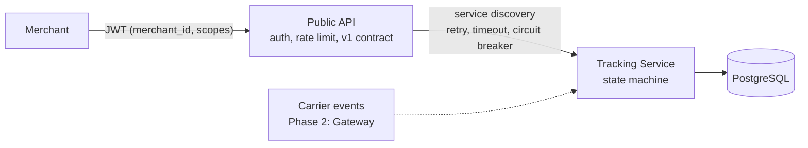

# CarrierHub

A shipment-tracking integration platform in .NET 10: it takes events from carriers with different,
unreliable APIs, turns them into one correct timeline per shipment, and serves it to merchants through
a secure public API. An AI ops assistant will answer questions about shipments through the same API,
with the caller's permissions.

**Status:** Phase 1 of 7 done (Tracking Service, Public API, PostgreSQL). [Roadmap](#roadmap)

## What works today



- **A timeline that stays correct when carriers misbehave.** Duplicate events are ignored, events that
  arrive out of order land in the right place, and a delivered shipment can't be "undelivered" by a late
  event. The status is recalculated from the whole timeline, so the arrival order can't change it.
  ([ADR 2](docs/adr/0002-shipment-status-from-the-full-timeline.md))
- **Safe under concurrent writes.** The database rejects a duplicate event even when two requests race,
  and optimistic concurrency (PostgreSQL `xmin`) stops one request from overwriting another's status.
- **Merchants only see their own data.** The merchant comes from the JWT, never from the URL. Another
  merchant's shipment is simply "not found".
- **Read and write are separate permissions** (`shipments:read`, `shipments:write`). The AI assistant
  will get a read-only token.
- **Per-merchant rate limiting**, so one merchant flooding the API slows down only itself.
- **A public contract of its own** (`/v1`), so internal fields never leak and Tracking can change
  without breaking merchants.
- **A clean 502 when Tracking is down**, with the details in the logs, not in the response.

## Tests

| Suite | Tests | What it proves |
|---|---|---|
| Domain | 13 | Status rules, duplicates, lateness; one test replays all 120 arrival orders of five events |
| Tracking API (Testcontainers, real PostgreSQL) | 7 | Races on the same event, merchant isolation, idempotent create, late search with a fake clock |
| Public API | 8 | Merchant from token, scopes, no internal fields, 502 on failure, rate limit per merchant |

```
dotnet test
```

Docker must be running: the Tracking tests start their own PostgreSQL container.

## Run it

Requirements: .NET 10 SDK, Docker Desktop.

```
dotnet run --project src/CarrierHub.AppHost
```

This starts PostgreSQL, Tracking and the Public API, and prints a link to the Aspire dashboard
(logs, traces, metrics). `src/CarrierHub.Tracking/CarrierHub.Tracking.http` and
`src/CarrierHub.PublicApi/CarrierHub.PublicApi.http` hold ready-made requests. Development tokens
come from `dotnet user-jwts`, for example:

```
cd src/CarrierHub.PublicApi
dotnet user-jwts create --claim merchant_id=merchant-1 --scope shipments:read --scope shipments:write
```

## Design decisions

- [ADR 1: Aspire for local development; Helm and Terraform for deployment](docs/adr/0001-aspire-for-local-development.md)
- [ADR 2: Shipment status is recalculated from the full timeline](docs/adr/0002-shipment-status-from-the-full-timeline.md)

## Roadmap

| Phase | What | Status |
|---|---|---|
| 1. Foundation | Tracking Service, Public API, PostgreSQL | Done |
| 2. Carrier integration | Mock carriers with fault injection, Carrier Gateway, resilience | Next |
| 3. Messaging | Azure Service Bus, transactional outbox, merchant webhooks | Planned |
| 4. Observability and load | One trace per carrier event, k6 load tests with real numbers | Planned |
| 5. AI assistant | Tool calling over the Public API, RAG over carrier SLAs, evaluations, MCP | Planned |
| 6. Cloud delivery | Docker, Helm, Terraform, AKS, GitHub Actions | Planned |
| 7. Publish | Demo video, final write-up | Planned |

## Tech

.NET 10, ASP.NET Core minimal APIs, EF Core with PostgreSQL (Npgsql), Aspire, OpenTelemetry,
Polly (through Microsoft.Extensions.Http.Resilience), JWT bearer authentication, ASP.NET Core rate
limiting, xUnit, Testcontainers.