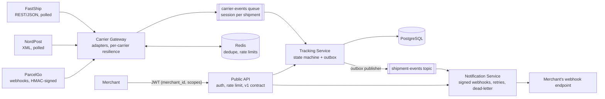

# CarrierHub

A shipment-tracking integration platform in .NET 10: it takes events from carriers with different,
unreliable APIs, turns them into one correct timeline per shipment, and serves it to merchants through
a secure public API and signed webhooks. An AI ops assistant will answer questions about shipments
through the same API, with the caller's permissions.

**Status:** Phase 3 of 7 done (messaging). [Roadmap](#roadmap)

## Architecture today



The queue and the topic are Azure Service Bus (the local emulator in development). The three carriers
and the merchant are simulated (`CarrierHub.MockCarriers`) so their failures can be switched on at will:
errors, latency, duplicates, shuffled order and rate limits.

## What works

**Messaging (Phase 3)**
- **Carrier events travel over Azure Service Bus.** One session per shipment keeps its events in order
  while different shipments are processed in parallel. A message is completed only after it is stored;
  one that can never be processed goes to the dead-letter queue with a reason.
  ([ADR 7](docs/adr/0007-carrier-events-over-service-bus.md))
- **Transactional outbox.** A status change and its outgoing message are saved in one database
  transaction, so a change is never lost or announced without being saved. A background publisher
  moves the rows to the `shipment-events` topic with `FOR UPDATE SKIP LOCKED`.
  ([ADR 8](docs/adr/0008-transactional-outbox.md))
- **Signed webhooks to merchants.** Merchants register a URL through `PUT /v1/webhook` and receive one
  webhook per status change, signed with HMAC-SHA256, with an event ID to drop repeats. Failed
  deliveries are retried, then dead-lettered and can be replayed. Every attempt is in the delivery log
  (`GET /v1/webhook/deliveries`). ([ADR 9](docs/adr/0009-merchant-webhooks.md))
- **At least once everywhere, idempotent receivers.** Every hop can repeat a message; Tracking (database
  key), Notification (delivery log) and the merchant (`CarrierHub-Event-Id`) all ignore a repeat.

**Carrier integration (Phase 2)**
- **Three carrier styles behind one event format.** FastShip (JSON, local times with an offset),
  NordPost (XML, Danish local time *without* an offset, including the clock-change hours) and ParcelGo
  (pushed webhooks). Each has an adapter; the rest of the platform never sees a carrier format.
- **Each carrier fails on its own.** Its own retry, timeouts and circuit breaker, polled side by side.
  A hanging NordPost doesn't delay FastShip. ([ADR 5](docs/adr/0005-per-carrier-resilience.md))
- **Redis dedupe in front of an idempotent receiver.** Events already forwarded aren't sent again; if
  Redis is down, the system is slower, never wrong. ([ADR 3](docs/adr/0003-redis-dedupe-in-front-of-an-idempotent-receiver.md))
- **A request limit per carrier, shared by all Gateway instances** through Redis.
- **Signed carrier webhooks.** HMAC-SHA256 over timestamp and body, checked in constant time, replays
  older than 5 minutes rejected, and 200 only once the event is accepted. ([ADR 6](docs/adr/0006-signed-webhooks.md))

**Tracking and the Public API (Phase 1)**
- **A timeline that stays correct when carriers misbehave**: duplicates ignored, out-of-order events
  placed correctly, a delivered shipment can't be "undelivered".
  ([ADR 2](docs/adr/0002-shipment-status-from-the-full-timeline.md))
- **Safe under concurrent writes**: the database rejects a duplicate even when two requests race, and
  optimistic concurrency (PostgreSQL `xmin`) prevents lost updates.
- **Merchants only see their own data**: the merchant comes from the JWT, never from the URL.
  Read and write are separate scopes; the AI assistant will get a read-only token.
- **Per-merchant rate limiting**, a public `/v1` contract of its own, and a clean 502 when a backend
  service is down.

## Measured results

| What | Result |
|---|---|
| Everything failing at once: FastShip 30% errors, 50% duplicates, shuffled; ParcelGo 50% duplicates, shuffled; merchant failing 50% of requests | 3 of 3 shipments delivered. The merchant got **14 webhooks with 14 different event IDs, all in order**. 49 repeats stopped by Redis. 2 deliveries failed after all HTTP retries; Service Bus redelivered both and they succeeded 2.3–2.5 s later. |
| Outbox, normal flow | Each message published **0.8–1.7 s** after the change was saved. |
| Outbox, Service Bus down | The change was saved at once; its message went out **68 s** later when the bus was back, before the next, newer one. |
| Merchant down for a whole journey | 4 messages tried 5 times each, then dead-lettered. Replay delivered all 4 **in order**. |
| Normal merchant delivery | **0.4–1.0 s** from status change to merchant. |
| Redis dedupe, same workload with and without | Calls to Tracking per new event: **7.8 → 1.0** (87% fewer). A model predicted ~120 wasted calls for the baseline; 123 were measured. |
| Isolation: NordPost hanging (20 s per call) | FastShip shipments delivered on their normal schedule. NordPost's circuit opened, went half-open after 30 s, closed, and its shipment caught up with no manual action. |
| Forged carrier webhooks | Rejected with 401; the shipment's timeline shows only the genuine delivery. |

Lesson from the chaos run: the merchant failed half its requests, but only 2 failures reached the delivery
log, because the HTTP client retries twice inside one delivery (0.5³ ≈ 12% of deliveries fail all three
tries). The log proves every message arrived once; it doesn't show how unhealthy a merchant is. That needs
a metric per HTTP try (Phase 4).

## Tests

| Suite | Tests | What it proves |
|---|---|---|
| Domain | 16 | Status rules, duplicates, lateness, domain events; one test replays all 120 arrival orders of five events |
| Tracking API (Testcontainers, real PostgreSQL) | 9 | Races on the same event, merchant isolation, idempotent create, late search, active shipments, outbox rows |
| Public API | 10 | Merchant from token, scopes, no internal fields, 502 on failure, rate limit per merchant, webhook endpoints |
| Carrier contracts | 18 | Real payloads per carrier; summer, winter and both clock-change hours; signatures, tampering and replays |
| Notification | 5 | Signed merchant webhooks, delivery log, one success per message |

```
dotnet test
```

Docker must be running: the Tracking tests start their own PostgreSQL container.

## Run it

Requirements: .NET 10 SDK, Docker Desktop.

Set the webhook secret once (any long random value; it stays in your user secrets, outside the repo):

```
dotnet user-secrets set "Parameters:parcelgo-webhook-secret" "<a long random value>" --project src/CarrierHub.AppHost
```

Then:

```
dotnet run --project src/CarrierHub.AppHost
```

This starts PostgreSQL, Redis, the Azure Service Bus emulator, the mock carriers and merchant, the Carrier
Gateway, Tracking, Notification and the Public API, and prints a link to the Aspire dashboard (logs,
traces, metrics). No Azure subscription is needed. The `.http` files in each project hold ready-made
requests, including fault injection for the mock carriers and the merchant. Useful checks:

- `GET /stats` on the Gateway: events published and repeats skipped
- `GET /merchant-hooks/merchant-1` on MockCarriers: what the merchant received
- `GET /v1/webhook/deliveries` on the Public API: every delivery attempt

Development tokens come from `dotnet user-jwts`:

```
cd src/CarrierHub.PublicApi
dotnet user-jwts create --claim merchant_id=merchant-1 --scope shipments:read --scope shipments:write
```

## Design decisions

1. [Aspire for local development; Helm and Terraform for deployment](docs/adr/0001-aspire-for-local-development.md)
2. [Shipment status is recalculated from the full timeline](docs/adr/0002-shipment-status-from-the-full-timeline.md)
3. [Redis dedupe in front of an idempotent receiver](docs/adr/0003-redis-dedupe-in-front-of-an-idempotent-receiver.md)
4. [Carrier times without an offset are read in the carrier's time zone](docs/adr/0004-carrier-local-times-without-an-offset.md)
5. [Each carrier fails on its own](docs/adr/0005-per-carrier-resilience.md)
6. [Carrier webhooks are signed, recent and acknowledged only once stored](docs/adr/0006-signed-webhooks.md)
7. [Carrier events travel over Azure Service Bus](docs/adr/0007-carrier-events-over-service-bus.md)
8. [Status changes are announced through a transactional outbox](docs/adr/0008-transactional-outbox.md)
9. [Merchants receive signed webhooks with retries, dead-lettering and replay](docs/adr/0009-merchant-webhooks.md)

## Roadmap

| Phase | What | Status |
|---|---|---|
| 1. Foundation | Tracking Service, Public API, PostgreSQL | Done |
| 2. Carrier integration | Mock carriers with fault injection, Carrier Gateway, resilience, signed webhooks | Done |
| 3. Messaging | Azure Service Bus, transactional outbox, merchant webhooks | Done |
| 4. Observability and load | One trace per carrier event, k6 load tests with real numbers | Next |
| 5. AI assistant | Tool calling over the Public API, RAG over carrier SLAs, evaluations, MCP | Planned |
| 6. Cloud delivery | Docker, Helm, Terraform, AKS, GitHub Actions | Planned |
| 7. Publish | Demo video, final write-up | Planned |

Not built yet from Phase 3: replay for parked carrier events, an outbox clean-up job, backoff over minutes
instead of immediate redelivery, encrypted webhook secrets, and an SSRF guard on merchant URLs.

## Tech

.NET 10, ASP.NET Core minimal APIs, EF Core with PostgreSQL (Npgsql), Azure Service Bus
(Azure.Messaging.ServiceBus, local emulator), Redis (StackExchange.Redis), Aspire, OpenTelemetry, Polly
(Microsoft.Extensions.Http.Resilience), JWT bearer authentication, ASP.NET Core rate limiting,
HMAC-SHA256 webhook signatures, xUnit, Testcontainers.
